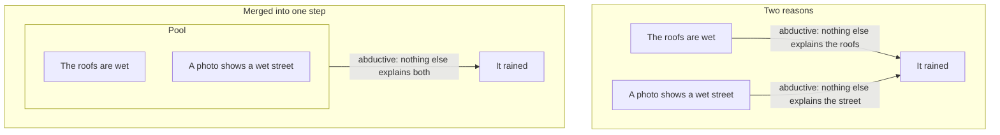
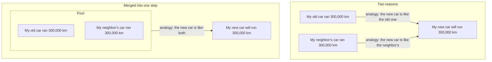

<!-- markdownlint-disable -->

# Plan

## Terminology

### Core logic terms

- **Thesis:** one claim.
- **Premise:** a thesis that a conclusion follows from. A conclusion's premises are the theses it follows from.
- **Conclusion:** a thesis with premises. Its step needs all of them; a pool counts as one premise, and reasons of different types are separate steps (see Convergence).
- **Inference:** a conclusion together with its premises; one step of reasoning.
- **Starting claim:** a thesis with no premises: either stated in the article and taken as given, or an implicit premise the reconstruction adds.
- **Final conclusion:** a conclusion that nothing else follows from.
- **Implicit premise:** a premise the author relies on but doesn't state; it fills a gap in a step (a missing premise). The original logic doesn't show it; the reconstructed logic adds it as a starting claim.
- **Implicit condition:** what a non-deductive step relies on without saying so: the cases are representative, nothing else explains the effect, the compared cases are alike in the respect that matters. It isn't a premise and isn't drawn as one, but it must hold like one: a weak condition limits the conclusion the way a weak premise does. The original logic doesn't show it; the reconstructed logic shows it on its step.

### Argument structure

- **Key point:** a conclusion that carries the argument: much of the reasoning gathers in it, and much of the reasoning toward the final conclusions continues from it. Chosen by the key point rule: conclusions ranked by the number of theses behind them times the number depending on them, cut where a score falls below half of the previous one, at most 7.
- **Foundation:** a starting claim that many conclusions depend on.
- **Concept:** a term that several theses use and that the reader needs to understand to follow the argument.

### Reasoning types

- **Reasoning type:** the rule by which an inference gets from its premises to its conclusion. A deductive rule guarantees the conclusion when the premises are true; every other rule also needs an implicit condition, which the reconstructed logic states. Each type has a fixed step strength (see Strength). A type is recognized by matching the step's premises to a rule.

#### Deductive

The conclusion follows necessarily from the premises.

- Rule: if A then B; A → B.
- Step strength: 1.
- Implicit condition: none.
- Typical issues: non sequitur, missing premise.
- Example: "If it rains, the street gets wet. It's raining. So the street is wet."
- Fails (non sequitur): "If it rains, the street gets wet. The street is wet. So it rained." A street cleaner could have wet it.

#### Generalization (inductive)

From cases to a general claim.

- Rule: cases 1…n have P → such cases have P.
- Step strength: 0.9.
- Implicit condition: the cases are enough and representative.
- Weak condition, known as: hasty generalization.
- Example: "Every swan I've seen is white. So swans are white."
- Fails (hasty generalization): all the swans seen were in Europe, and black swans live in Australia.

#### Abductive (best explanation or best action)

From a given effect, observed or wanted, to the cause that best accounts for it.

- Rule: effect E is observed or wanted; C would bring about E → C.
- Step strength: 0.8.
- Implicit condition: no other cause fits E as well, and C's other consequences hold up. For an observed effect: not chance, another cause or the reverse direction, and C's other consequences match what's observed. For a wanted effect: no better action, and the side effects are acceptable.
- Weak condition, known as: post hoc, questionable cause, ignored alternative.
- Example, observed effect: "The grass is wet this morning. Rain overnight would explain it. So it rained."
- Fails (questionable cause): the sprinklers ran overnight.
- Fails (post hoc): "I took a vitamin and my cold went away, so the vitamin cured it." Colds go away on their own.
- Example, wanted effect: "I want to be at work by 9. The train gets me there by 8:45. So I'll take the train."
- Fails (ignored alternative): cycling gets there by 8:30 and costs nothing.
- Not this type: a prediction from cause to effect, which is deductive.

#### Analogy

What holds for one case holds for another.

- Rule: A has P; B is like A → B has P.
- Step strength: 0.7.
- Implicit condition: A and B are alike in the respect that matters for P.
- Weak condition, known as: weak analogy.
- Example: "My old car of this model ran 300,000 km. My new car is the same model. So it will run 300,000 km too."
- Fails (weak analogy): the new one has a different engine, and the engine is what matters for mileage.

#### Convergence

A rule for merging steps, not a reasoning type. Reasons of the same type for one conclusion, each of which would support it alone, are merged into one step, and their premises form a pool.

- Pool: the premises the merged reasons each contribute (the observations or source cases), taken together. It counts as one premise; the step's other premises stay as they are. A doubtful item doesn't limit the conclusion, and each added item raises the pool (see Pool strength).
- Abductive: one step over all the observations, whose implicit condition is "nothing else explains all of them".
- Analogy: one step from several source cases, whose implicit condition is "B is like all of them in the respect that matters".
- Generalization: excluded; its cases are already the premises of one step.
- Different types: reasons of different types aren't merged. Each is its own step, computed on its own, and their results combine like pool members (see Pool strength), so a reason of another type never lowers the conclusion.
- Example, abductive: "The roofs are wet" and "a photo shows a wet street" merge into one abductive step for "it rained", with the implicit condition "nothing else explains both". The street cleaner explains only the street, so it drops out; dew explains both and remains the alternative to rule out.

- Example, analogy: "My old car of this model ran 300,000 km" and "my neighbor's car of the same model ran 300,000 km" merge into one analogy step for "my new car will run 300,000 km", with the implicit condition "the new car is like both in the respect that matters". My careful driving explains only my old car, so it drops out as the difference that matters; a new engine in this year's model breaks the likeness to both and remains the difference to rule out.

### Logic versions

- **Original logic:** the reasoning as the author gives it.
- **Reconstructed logic:** the original made explicit by the rules in Reconstruction. Every issue that has a fix is repaired, and issues with no fix stay visible.
- **Optimized logic:** the reconstructed logic reduced to the fewest starting claims that still yield the same final conclusions at the same strength. Final conclusions with strength 0 stay as they are; only the support of the others is reduced.

### Reconstruction

The rules that turn the original logic into the reconstructed logic. Fixes are linked to the issues they repair; the other changes only make the logic explicit and need no issue.

- **Fix:** one minimal change that repairs one issue and keeps the author's conclusion: state an implicit premise, split a thesis, change a conclusion's premises, or reword a thesis. Some issues have none, for example an inconsistency or an irrelevant conclusion. A premise that only restates the step ("if the premises hold, the conclusion holds") is not a fix.
- **Implicit premises:** a gap with a plausible fix gets an implicit premise. It's added as a starting claim, linked to the issue it fixes, and judged like any other starting claim.
- **Implicit conditions:** every non-deductive step gets one. It's shown on its step and rated by its reasoning type's criteria.
- **One claim per thesis:** a thesis that bundles several claims is split, even when no issue calls for it. Otherwise one weak part makes every conclusion that uses it weak, even those that need only its strong parts.
- **Convergence:** reasons of the same type for one conclusion are merged into one step with a pool; reasons of different types stay separate steps (see Convergence).
- **Summaries:** a final conclusion that restates earlier conclusions is deductive. A claim in it that nothing earlier argues is a gap, not a different reasoning type.

### Strength

**A thesis's strength is its step's strength times the weakest of its premises and its implicit condition. A starting claim's strength is its verdict's number; a definition's is 1.** It's a number from 0 to 1, computed in the reconstructed logic. The LLM picks reasoning types, verdicts and ratings, never decimals; each has a fixed number, below.

**Why:** what a step needs and the step itself fail differently:

- **Premises and implicit conditions don't add up:** a step needs all of them, so it's only as strong as the weakest one. Five weak premises are no weaker than one, sharing a premise changes nothing, and splitting a thesis changes nothing for a conclusion that uses all its parts.
- **Steps add up along a chain:** each non-deductive step is a leap with its own risk, so the step strengths multiply. Three abductive steps in a row cost 0.8³ even when everything they rest on is supported.
- Unrolled, a thesis is as strong as its weakest chain: the number of a starting claim or implicit condition, times the strength of every step from it up to the thesis. A pool is the exception: it combines the chains of its members (see Pool strength).

#### Step strength

Fixed by the reasoning type, the same for every step of the type: the built-in risk of that kind of step.

- `Deductive`: 1
- `Generalization`: 0.9
- `Abductive`: 0.8
- `Analogy`: 0.7

#### Starting claim strength

A starting claim's verdict measures how well its backing in the article matches what the claim says. The same backing can make a modest claim supported and a sweeping one weak. Explicit starting claims and implicit premises are judged alike.

- **Checks** for a factual claim:
  - **Source:** named and checkable, or anonymous? When the source is an expert: competent on this exact point, and other experts don't disagree.
  - **Kind of backing:** a controlled study, a case, an anecdote, or a bare assertion?
  - **Scope:** does the backing cover as much as the claim says?
  - **Relevance:** is the backing about the same thing as the claim?
  - The author's own hedges ("unverified", "a single project") count against a claim that goes beyond them.
- **Verdicts** and their numbers:
  - **Supported, 0.95:** a checkable source that covers the claim's scope, or common knowledge nobody disputes. Example: "Water boils at 100 °C at sea level."
  - **Weak, 0.6:** some backing, but it falls short on at least one check. Example: "Remote teams are more productive", backed by one company's survey.
  - **Unsupported, 0:** only the author's assertion. Example: "Most startups fail because of bad hiring", with no backing.
  - **False, 0:** contradicted by the article itself or, if outside sources are used, by a checked source. Example: "The Great Wall of China is visible from space with the naked eye."
- **Definitions, 1:** not rated, and they don't limit strength. Example: "A sprint is a fixed time box." Using a term in two senses is an equivocation issue.
- **Expert backing:** "A cardiologist says this drug lowers blood pressure" is supported; "A cardiologist says this tax policy is good" is weak, because the expertise doesn't cover the claim.
- **Value judgments:** supported if most readers would accept them, weak if contested. Examples: "Code should be readable" is supported; "Tabs are better than spaces" is weak.
- **Reason:** every verdict has a short reason that points to the backing in the article, or says there is none.

#### Implicit condition strength

The implicit condition of a non-deductive step is rated by its reasoning type's criteria, not by the starting claim checks, with the same numbers as the verdicts: strong 0.95, weak 0.6, none 0. In the reconstructed logic it's shown on its step, marked added. The familiar fallacy names (hasty generalization, post hoc, questionable cause, ignored alternative, weak analogy) aren't issue types: they serve as reasons for a weak or none rating, for example "weak: post hoc, no alternative ruled out".

- **Generalization:** strong with many varied cases, not hand-picked, no known counterexamples, and a conclusion no broader than the cases ("most", not "all"); weak with few or similar cases; none with a single case behind a general claim.
- **Abductive:** strong when the main alternatives are ruled out and the cause explains all the observations, or, for a wanted effect, when the alternatives were compared and the side effects are acceptable; weak when the alternatives weren't checked; none when an alternative fits better or an observation contradicts the cause. Each added independent observation that the cause explains and an alternative doesn't counts toward strong.
- **Analogy:** strong when the source and target cases share the features that matter for P and no relevant difference is known; weak when they're similar in general but the relevance isn't shown; none when a difference that matters is known. Each added source case that shares P but differs from the others in some feature counts toward strong: it shows that feature doesn't matter.
- Example: in "Every swan I've seen is white → swans are white", the step's implicit condition is "the swans I've seen are representative of all swans" (added, weak: all of them were in Europe).

#### Pool strength

A pool's members are alternative evidence, so each member closes its share of the gap that remains to 0.95: 0.95 × (1 − (1 − s₁/0.95)(1 − s₂/0.95)…), where s is each member's strength, counted as at most 0.95. The larger the pool, the stronger it is, approaching 0.95: nothing that can be wrong scores above supported.

- **Numbers:** one member: the member itself. Weak members: two 0.82, three 0.90, four 0.93, five 0.94. A supported member and anything else: 0.95. Four weak members stay below one supported member.
- **Independence:** members that rest on the same source count as one member; otherwise the same survey quoted three times would count three times.
- **Example:** "the roofs are wet" (weak) and "a neighbor's photo shows a wet street" (weak) form a 0.82 pool, stronger than either alone.
- **A member also used outside the pool** counts there on its own.
- **Reasons of different types** for one conclusion combine the same way: each step's result counts as a member.
- **The implicit condition** also grows with the pool: more independent observations or source cases rule out more alternatives or differences (see Implicit condition strength).

#### Examples

- "Copper is a metal (supported). Metals conduct electricity (supported). So copper conducts": deductive, 1 × 0.95 = 0.95. If "copper is a metal" were weak: 1 × 0.6 = 0.6.
- "80% of 2,000 randomly chosen viewers liked the film. So most viewers like it": generalization with the implicit condition "the viewers are representative", strong: 0.9 × 0.95 = 0.86. "3 friends liked it. So people like it": the implicit condition is weak: 0.9 × 0.6 = 0.54.
- "The grass is wet; the sprinklers were off, and the roofs are wet too. So it rained": abductive with the implicit condition "nothing else explains it", strong: 0.8 × 0.95 = 0.76. The same without checking the sprinklers: 0.8 × 0.6 = 0.48.

#### Original logic

It doesn't show implicit premises or conditions, so its theses show the values computed in the reconstructed logic.

#### Exception, a flaw with no fix

A flaw with no fix, such as an inconsistency or an irrelevant conclusion, doesn't come from any starting claim or implicit condition, so the thesis is set to 0.

### Graph

The map shows the logic as a graph:
- **Node:** a thesis, with its number and label.
- **Arrow:** from a premise to the conclusion that follows from it. A conclusion's incoming arrows are its inference.
- **Ends:** a starting claim has no incoming arrows, and a final conclusion has no outgoing ones.
- **Implicit premises and conditions:** shown only in the reconstructed and optimized logic, marked as added. An implicit premise is a node like any starting claim; an implicit condition sits on its step, not as a node.
- **Pool:** a box around its members, with one arrow from the box to its conclusion.
- **Strength, verdicts and issues:** shown as marks on nodes and arrows.
- **Key points and concepts:** listed in the Summary view; each one opens the graph at its theses.

### Audit

- **Issue:** a place where the reasoning fails or is weak. It targets an inference, a thesis, a concept, a pair of theses or the whole argument.
- **Issue type:** the kind of problem, from a fixed list:
  - **Non sequitur:** the conclusion doesn't follow from its premises, and no plausible implicit premise would make it follow.
  - **Missing premise:** the conclusion follows only with a premise the article doesn't state but plausibly relies on. The reconstructed logic states it as an implicit premise.
  - **Circular reasoning:** a premise already assumes the conclusion.
  - **Equivocation:** one term used for two different concepts, so an inference connects claims about different things.
  - **Straw man:** an opposing view restated in a weaker form, then refuted.
  - **Inconsistency:** two theses that can't both be true.
  - **Irrelevant conclusion:** the conclusion answers a different question than the one the article posed.
- **Severity:** flaw or weakness.
  - **Flaw:** breaks the reasoning; some conclusion doesn't follow as stated.
  - **Weakness:** the reasoning holds, but less firmly than the article presents it.
- **Verdict:** for a starting claim: supported / weak / unsupported / false.

## Goal

Extend ergomap from an argument map to an argument analysis. A page shows:
- Key points
- Key concepts
- Starting claim verdicts
- Original logic
- Reconstructed logic
- Optimized logic: the same final conclusions at the same strength, with fewer starting claims

Examples refer to the theses in [examples/sdd-scrum-kanban.json](../examples/sdd-scrum-kanban.json).

## UI

1. **Summary:** final conclusions and key points, each with its strength, and key concepts. A strength lowered by a weak rating or a flaw names its weakest link, for example "0.48, weakest: 'fit' is judged after the fact (18)".
2. **Audit:** issues (fallacies, gaps) and starting claim verdicts
3. **Logic:** original, reconstructed and optimized, as three states of one map

The audit adds one item to the goal: an explicit list of issues. Every fix in the reconstructed logic points to the issue it fixes; without the list, the reconstructed logic is a black box. The audit covers both halves of judging an argument:
- **Issues:** does each conclusion follow from its premises?
- **Starting claim verdicts:** are the starting claims true?

## Skill

To be drafted: changes to [skill/SKILL.md](../skill/SKILL.md) for the audit steps and, depending on decision 6, the two modes.

## Decisions

Open unless marked decided; the recommended option is first.

### UI

1. Page structure:
   1. Three views, Summary, Audit and Logic, opening on Summary (recommended)
   2. One scrolling page with the summary and the audit above the map (on phones, panning and zooming the map fights with page scrolling)
   3. Map only, with the summary and the audit in the side panel when nothing is selected
2. Issue names:
   1. Plain name first, textbook name in parentheses (recommended)
   2. Textbook names only
3. How to show the versions:
   1. One map with a version switch and stable positions (recommended)
   2. Graphs side by side (doesn't fit on screen and breaks on phones)

### Audit

4. Issue types (decided): hasty generalization, post hoc, questionable cause, ignored alternative and weak analogy are not supported. They name the weak end of a scale as if it were a yes/no: a generalization from 3 cases is weaker than one from 2,000, not "hasty" while the other is "fine". The strength of a generalization, an abductive step or an analogy is ranked instead, by its step strength and its implicit condition's rating (see Strength); the names stay as reasons for a weak or none rating.

### Data

5. How to store the versions:
   1. Each version is a complete list of theses, with ids shared across versions, and the viewer computes the differences (recommended: each version validates on its own, and it's easy for the LLM to write)
   2. Reconstructed and optimized as edit operations on the original (compact, but hard to write and validate)
   3. A separate data file per version

### Skill

6. What the skill does:
   1. Two modes: map only (as now) and full analysis (recommended: the analysis costs several times more tokens and isn't always wanted)
   2. Always the full analysis

## Phasing

1. Issues and starting claim verdicts: marks on the original map and the Audit view
2. Key points and key concepts
3. Reconstructed and optimized logic, and strength, which is computed in the reconstructed logic

## Open questions

- Starting claim verdicts: only the article, or outside sources too?
